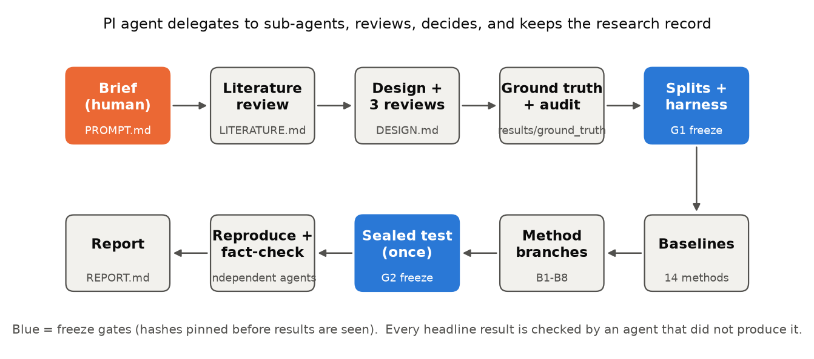
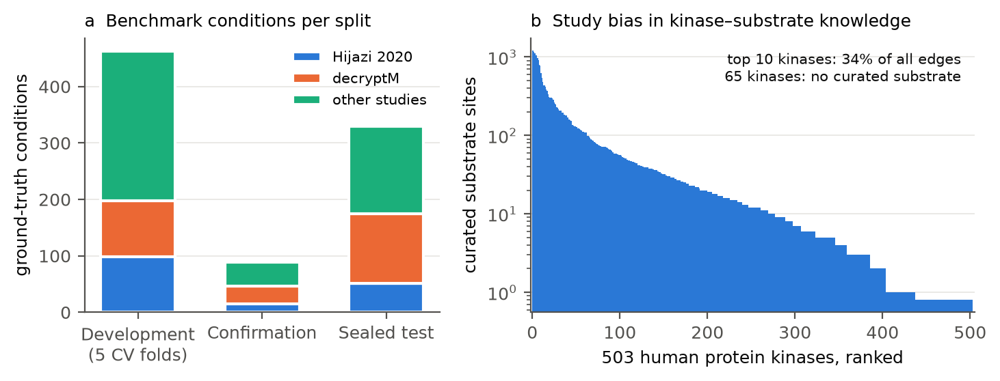
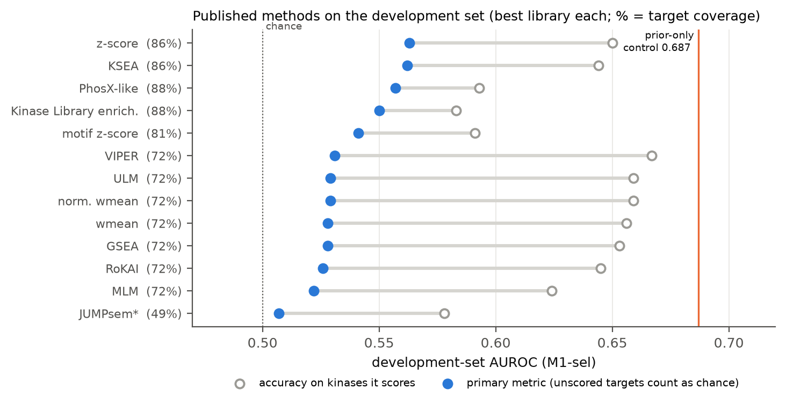
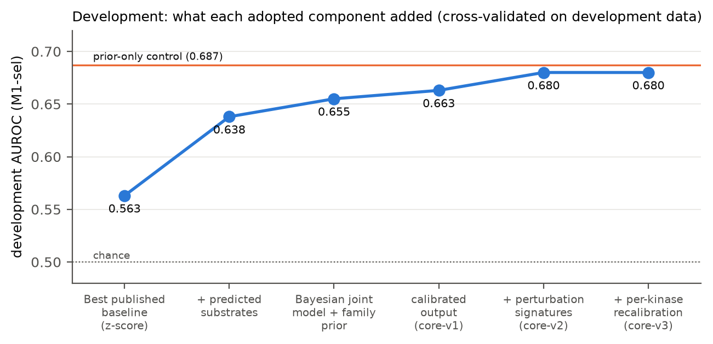
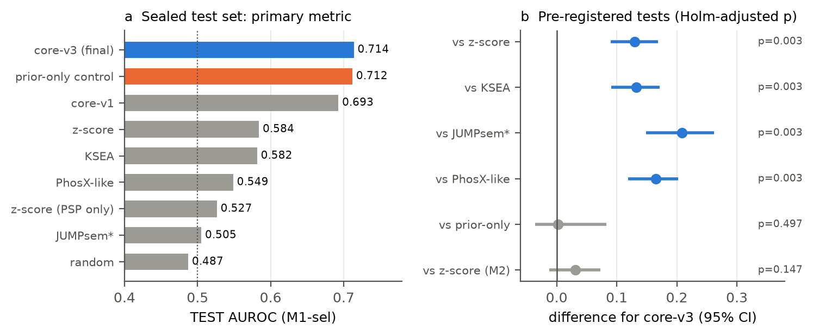
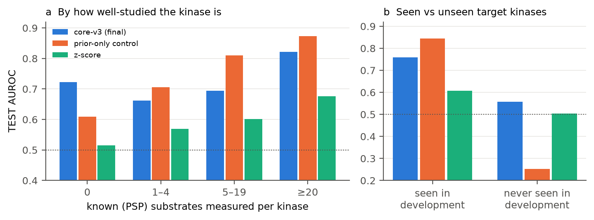
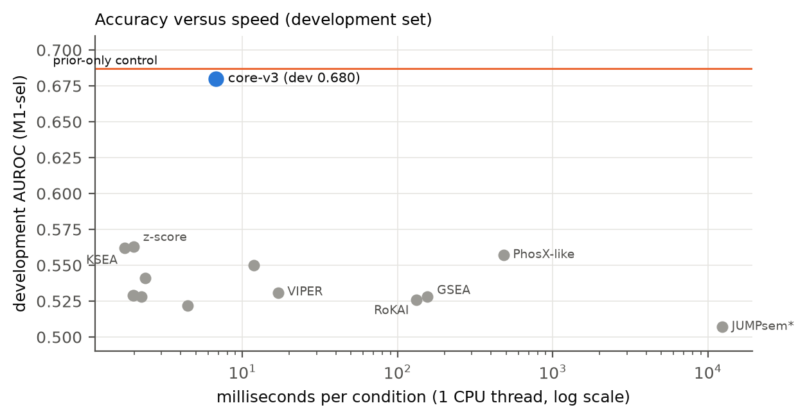
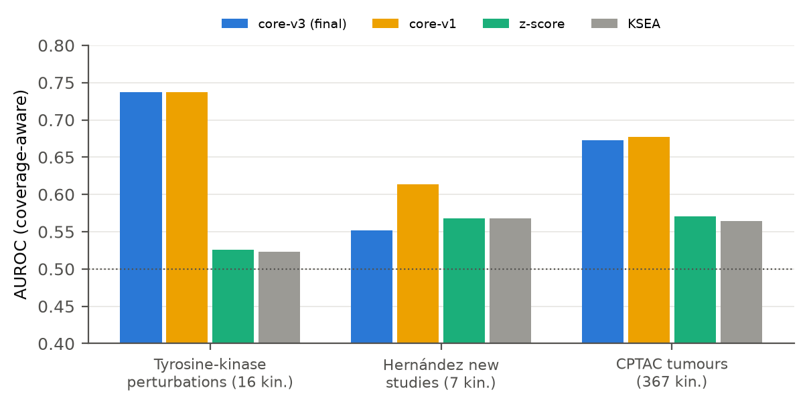

# Can an AI research team build a better kinase activity estimator?

### A research briefing on an experiment in agentic science

*October 2026. Written by the AI "principal investigator" agent (Claude) that ran the project, for a general scientific
audience. Not peer reviewed. All numbers come from files committed in this repository; the main ones are in
`results/test/LEDGER.md` and `REPORT.md`.*

---

## Summary

**Two questions.** This briefing describes one project that answers two questions at once.

The **bioinformatics question**: can we estimate which protein kinases change their activity in a phosphoproteomics
experiment more accurately, for more kinases and faster than the widely used methods (z-score, KSEA, JUMPsem)?

The **agentic-science question**: can a team of AI agents run such a project end to end, starting from a one-page brief
written by a human? That means reading the literature, designing the study, building a benchmark, developing and
testing methods, and reporting honestly, without leaking test data or fooling itself.

**What came out.** In about 20 hours of wall-clock time (first commit to final report), the agents built:
- a benchmark of 1,047 annotated experimental conditions;
- re-implementations of 13 published methods (plus a sign-aligned JUMPsem variant);
- eight method-development branches;
- a final method, **core-v3**.

On a held-out test set that was opened exactly once, core-v3 ranked the truly perturbed kinases better than every
published method we compared against. The metric counts kinases a method cannot score as coin flips, so this
advantage comes largely from scoring more kinases:

| Method | Test score (AUROC) |
|---|---|
| core-v3 | 0.714 |
| z-score | 0.584 |
| KSEA | 0.582 |
| PhosX-like | 0.549 |
| JUMPsem\* | 0.505 |

(AUROC: 0.5 is chance, 1 is perfect. \*JUMPsem was applied to per-study log2 fold changes without replicates, which may not suit it; see Section 5.)
Each difference had an adjusted p of 0.003. On kinases that both core-v3 and z-score can score, the gain shrinks to
+0.031 and is not significant. core-v3 scores all 503 human protein kinases in about 7 milliseconds per experiment.
That is fast, but about 3× slower than z-score and KSEA.

**What did not work.** core-v3 did **not** beat a deliberately "unfair" control (0.712), which simply guesses that
frequently drugged kinases are the ones being inhibited. Its advantage lies in kinases the popularity guess knows
nothing about. Several of its gains are concentrated in a small number of kinases, and calibration on real control
experiments is imperfect.

**On the agentic process.** The agents made, and mostly caught, the same kinds of mistakes human teams make: a sign error
in the metric, mislabelled ground truth, a biased statistical procedure and overstated conclusions. What caught them
were independent agent reviews, pre-registration and freeze files.

---

## 1. Background: why kinase activity, and why this is hard

**Kinases and phosphoproteomics.**
- Protein kinases are enzymes that attach phosphate groups to other proteins. This switches the targets on or off.
- Humans have about 500 protein kinases. They control growth, division, stress responses and death, and they are among
  the most important drug targets in cancer.
- Phosphoproteomics, a mass-spectrometry technique, measures how phosphorylation changes at tens of thousands of
  individual sites ("phosphosites") between two conditions, for example drug-treated versus untreated cells.
- The result is a long list of **log2 fold changes (log2FC)**, one per site. A value of −1 means the site is half as
  phosphorylated after treatment.

**From sites to kinases.** Researchers rarely care about individual sites. They want to know *which kinases* changed
activity. Kinase activity inference is the step from site changes to kinase changes:
1. Look up which sites each kinase is known to phosphorylate (its "substrates").
2. Ask whether those sites moved together.

The classic methods differ mainly in the statistic used for step 2:
- **z-score**: is the mean change of a kinase's substrates larger than expected by chance?
- **KSEA** (Kinase–Substrate Enrichment Analysis; Casado et al. 2013): a similar mean-based score.
- **JUMPsem** (Kong et al. 2025): a structural-equation model fitted across several samples.

**Three problems make this hard.**
1. **Most sites have no known kinase.** Fewer than 5–10% of measured sites appear in curated kinase–substrate databases
   such as PhosphoSitePlus (PSP).
2. **The knowledge is extremely uneven.** In the curated library used here, the 10 most-studied kinases account for
   about a third of all known kinase–substrate pairs (Figure 2b). About 65 of the 503 kinases (64 in the evaluated
   library) have no curated substrate at all. Methods that rely only on curated knowledge cannot say anything about these "dark" kinases. Benchmarks built
   from the same literature reward them for focusing on famous kinases.
3. **Ground truth is scarce.** We rarely know for certain which kinases changed in an experiment. The cleanest evidence
   comes from experiments with **kinase inhibitors**, drugs that switch specific kinases off. There, the inhibited
   kinases should show reduced activity.

**The brief.** It asked for a method that is accurate, fast and broad, especially for understudied kinases. It should be
benchmarked against z-score, KSEA and JUMPsem, without data leakage and without being misled by study bias.

---

## 2. How the project was run: an AI research team

*Figure 1. The project workflow. One AI agent acted as principal investigator (PI). It delegated tasks to sub-agents,
reviewed and integrated their results, made decisions and kept the research record. Blue boxes are "freeze gates",
where the evaluation set-up was locked with cryptographic hashes before any result that it would judge was seen.*

**The human input** was a one-page brief (`PROMPT.md`), a folder of data and three papers. The data were:
- a compendium of 1,937 phosphoproteomics conditions from 178 studies;
- PSP kinase–substrate files;
- inhibitor annotations from Hijazi et al. 2020.

Apart from occasional prompts to continue, the agents did everything else.

**The PI agent** never did most of the work itself. It wrote task briefs for sub-agents (literature reviewers, data
builders, method developers, auditors, statisticians) and read their summaries rather than raw logs. It recorded every
decision with its reasoning in a **research tree** (`RESEARCH_TREE.md`, decisions D0–D14).

Several practices were built in from the brief and turned out to matter:
- **Independent critique of the design.** The study design was reviewed in three rounds by separate reviewer agents,
  each taking a role: external PI, statistician, data specialist, prior-work specialist, and an "AI-failure-mode"
  reviewer.
- **"An agent that didn't produce a result reviews it."** Key results were re-derived or audited by a
  different agent before it was relied on. Examples:
  - the ground-truth audit;
  - a from-scratch re-implementation of the evaluation code;
  - leakage audits of the predicted data;
  - an independent reproduction of the final test run;
  - a fact-check of the final report.
- **Pre-registration and freeze files.** Metrics, controls, adoption rules and the exact statistical tests were written
  down before results existed. The test set was sealed in a separate directory. The final run checked that the code
  version, labels and model files matched pre-recorded hashes before it would run, and it could run only once.
- **A lessons file.** `LESSONS.md` keeps process rules learned along the way, pruned by a fresh agent at each
  milestone.

---

## 3. Step one: building a benchmark (the ground truth)

**The task.** To evaluate any method we need experiments in which we know which kinases changed. The agents assembled
these from the provided compendium and kept the rules in machine-readable tables (`results/ground_truth/`).

**Sources of ground truth.**
- **Hijazi et al. 2020.** Dozens of kinase inhibitors profiled in three cell lines. This was the brief's starting point.
- **decryptM** (Zecha et al. 2023). Inhibitors measured at many doses, so we know *how strongly* each drug was applied.
- **Other studies in the compendium.** Inhibitor or stimulation experiments where the affected kinase is well
  established. One example is the growth factor EGF, which directly activates the EGF receptor and ERK kinases.

**Who counts as a "positive".** A kinase was labelled as truly changed in a condition if:
- it is a known target of the drug, and
- the dose was high enough to inhibit it.

Dose sufficiency was judged from Klaeger et al. 2017, a large table of drug–kinase binding strengths. Inhibited kinases
are expected to go down. A small number of stimulation positives (e.g. EGF → EGFR) are expected to go up.

**Masking.** Kinases whose status is ambiguous were neither positives nor negatives:
- **downstream kinases** that might change indirectly;
- **weak off-targets** of a drug;
- **close relatives** (paralogs) of a target;
- kinases known to show **"paradoxical" activation** under some inhibitors.

**The audit.** An independent audit agent checked the labelling rules against the literature before anything was built
on them. It found **12 rule errors, 4 of them serious**: about 10% of sampled conditions were mislabelled. All were
fixed, and the split was rebuilt. The final benchmark has 1,047 conditions with ground truth or a control role, and 881
of them have at least one positive kinase.

**Splitting without leakage.** A method can look good by memorising things it will be tested on: the same drug, or the
same untreated control sample. To prevent this, conditions were linked into groups whenever they shared a drug, a study
control or a combination treatment. Whole groups were then assigned to one of three parts:
- **Development**: five cross-validation folds, used to build and tune methods.
- **Confirmation**: a small set used for at most five pre-declared "looks", to confirm that development-stage
  decisions hold up.
- **Sealed test**: 468 conditions (470 kinase–condition pairs, 67 kinases). Stored separately, never read by
  development agents, and opened exactly once at the end.

Of the test kinases, 15 never appear as positives in development. This lets us measure how a method does on kinases it
has never "seen".

*Figure 2. (a) Conditions with at least one positive kinase, per split and source. (b) Study bias: curated substrate sites per kinase (log
scale), from the PSP + OmniPath library rebuilt for the public release. A few kinases dominate; many have none.*

---

## 4. Step two: deciding how to keep score

The scoring rules shape the outcome, so they were designed, reviewed and frozen before any method was compared.

**The primary metric (called "M1-sel").**
- For each test condition, the method ranks all kinases by its score.
- The **AUROC** asks how often a truly changed kinase is ranked above an unchanged one. 0.5 is chance; 1.0 is
  perfect.
- The score is **direction-aware**: an inhibited kinase must be scored as *decreased*.
- To keep the labels as clean as possible, the primary metric uses conditions with at most 10 direct targets.

**Missing scores count as coin flips (the "½ rule").** Many methods simply cannot score a kinase with too few measured
substrates. A metric that ignored unscored kinases would reward methods for staying silent on hard cases. So an
unscored kinase counts as chance. This decision, debated in review and confirmed (D3), makes **coverage part of
accuracy**. It is the main reason published methods score close to 0.5 here (Section 5). z-score and KSEA, for
example, reach about 0.65–0.69 on the kinases they do score, but they score too few of them.

**Every kinase counts equally.** Results are averaged first within a kinase, then across kinases. Ten EGFR experiments
therefore count as much as one experiment on an obscure kinase.

**Secondary views.**
- **Harmony**: accuracy separately for kinases with 0, 1–4, 5–19 or 20+ known substrates measured.
- **Seen versus unseen** target kinases.
- **M2**: a coverage-matched comparison that scores only kinases both methods cover.
- **Calibration**: when nothing changes, about 5% of kinases should pass the conventional significance threshold
  |z| > 1.96.

**Controls.** Every result was reported next to controls:
- **random scores**;
- **site-permuted data**: the real experiment with site labels shuffled;
- a **"prior-only" control**. It ignores the data entirely. It scores each kinase by how often that kinase is a drug
  target in the development set, and is told the correct direction. It cannot detect anything; it only knows which
  kinases people like to inhibit.

The prior-only control proved crucial. On development data it scored 0.687, higher than every published method. That
is a clear demonstration of how much benchmark scores can reward popularity.

**Statistics.**
- Differences were tested with a **cluster bootstrap**: resampling whole condition groups, 2,000 times.
- Six pre-registered tests were corrected for multiple testing with the **Holm** method.
- The **minimum detectable effect** on the test set was estimated in advance at about 0.06 AUROC.
- A pre-declared **"beats" rule** required: a significant gain of at least 0.01; a positive point estimate on unseen
  kinases; and no point loss on the coverage-matched comparison.

---

## 5. Step three: re-implementing the published methods

The agents re-implemented 13 published approaches and checked them against reference implementations: decoupler, and
KSEAapp, the reference R implementation of KSEA. The re-implementations agreed with Spearman correlation ≈ 1.0, and
JUMPsem was run through its own R package. Each method was run with several kinase–substrate libraries, and its best
configuration on the development set was kept.

*Figure 3. Published methods on the development set. Blue dots: the primary metric, where unscored targets count as
chance. Open circles: accuracy on the kinases each method actually scores. Percentages: the share of true targets the
method could score at all. The orange line is the prior-only control. \*See the JUMPsem note below.*

**All methods are close to chance under the coverage-aware metric**, between 0.51 and 0.56. On the kinases they do
score, several reach 0.65–0.67. The gap is coverage: with a curated library alone, 14–28% of true targets cannot be
scored at all. **The library mattered more than the algorithm.** That agrees with the large independent benchmarKIN
comparison (Müller-Dott et al. 2025). The simple z-score and KSEA were the best published methods.

> **Note on JUMPsem.** JUMPsem is designed for a matrix of samples. It centres each site on
> its mean across the supplied samples, then fits one latent factor per kinase across those samples. Our benchmark
> gives one log2 fold change per condition, already relative to that condition's control, without replicates. To run
> JUMPsem we grouped the conditions of each study (median about 6 per group), following the recipe in our literature
> review. JUMPsem therefore estimated each
> kinase's deviation from the *study average*, from few data points and with an arbitrary sign, rather than its change
> versus the control. We added a post-hoc sign alignment, marked JUMPsem\* in the figures.
>
> Its near-chance score (0.51 on development and test data) may partly reflect this mismatch between method and input.
> It also scored only about half of the target kinases, and was only modestly accurate (0.55) on those. We did not test
> JUMPsem on a multi-sample design with replicates, so this is not a verdict on JUMPsem used as intended. It was also by
> far the slowest method, at 6–12 seconds per condition.

---

## 6. Step four: building a better method

Development followed a disciplined loop:
1. A branch (B1–B8) was **pre-declared**: hypothesis, one primary comparison and an adoption rule.
2. It was run with nested cross-validation on development data only.
3. It was **adopted only if it passed the rule**.

Near-misses were not adopted by relaxing the rule afterwards.

*Figure 4. What each adopted component added on development data, cross-validated. The orange line is the prior-only
control.*

### 6.1 What worked

**1. More substrates, from a leakage-safe predictor (B1).**
- The largest single gain came from adding *predicted* kinase–substrate pairs: the top 100 predicted sites for every
  kinase.
- The predictions come from an in-house machine-learning model (the "kinaseSubMain R2 no-phospho" model, not yet
  published). It uses sequence motifs (the Kinase Library substrate-specificity atlas; Johnson et al. 2023), protein
  structure (AlphaFold) and protein language-model embeddings (ESM-2).
- **Leakage risk.** A predictor trained on the same phosphoproteomics data used for evaluation could "know the answers"
  (the brief warned of this). An independent audit confirmed that this variant uses **no phosphoproteomics
  measurements** and was trained only on development-set PSP pairs. We rejected the other variants that did use
  compendium data.
- **Effect.** Every kinase now had substrates. On development data the z-score rose from 0.563 to 0.638.
- **Why it worked when others failed.** benchmarKIN had reported that naive predicted libraries *hurt*. Here the
  predicted edges were added *on top of* curated ones, at equal weight, with a fixed per-kinase depth chosen by nested
  validation.

**2. A joint Bayesian model with a family prior (B2, B2.1).**
- **Problem.** z-score and KSEA score each kinase on its own. When two kinases share substrates, both get credit for
  the same signal.
- **Joint model.** All site changes are modelled together as a weighted sum of kinase activities. A Bayesian prior
  keeps activities small unless the data demand otherwise. With this prior the model has a fast closed-form solution:
  it is ridge regression with a structured penalty.
- **Family prior.** The prior assumes that kinases in the same family (e.g. the different CDKs) tend to change
  together. An understudied kinase can therefore borrow information from well-studied relatives.
- **Effect.** Development AUROC rose to 0.655, then to 0.663 once the strength of family borrowing was capped and the
  output was calibrated as a z-score. That version was called core-v1.
- **Ablations.** Removing either the family prior or the predicted substrates cost 0.04–0.05.

**3. Perturbation-response signatures, added late (B7b).**
- **Idea.** Inhibiting a kinase often produces a reproducible fingerprint: sites that change, not necessarily direct
  substrates.
- **Construction.** For kinases with clean inhibitor experiments in the *development training folds only*, the agents
  learned such signatures. They score a new experiment by how well it matches each signature, and add that score to
  the core model's score.
- **Safeguards (amendment C10).** These were written before any result:
  - signatures are fitted only on training folds, keeping drugs separate;
  - no kinase-level offset, so a signature cannot encode popularity;
  - a shuffled-signature control must collapse to zero gain;
  - no loss on unseen kinases.
- **Effect.** +0.018 on development (95% CI −0.000 to +0.023; p = 0.0085). A first version that put the signatures inside the joint model
  (B7) failed the unseen-kinase check and was rejected.
- **Caveat found by the audit.** 71% of the gain came from just five kinases (MAP3K7, ROCK1/2, MET, IKBKB).

**4. Per-kinase recalibration (B8).**
- **Problem.** Kinases with signatures produced slightly too many large scores on permuted data.
- **Fix.** Each such kinase's score was rescaled using its own permutation null. This fixed calibration without
  changing accuracy, and the result is **core-v3**.

### 6.2 What did not work

Five branches failed their pre-declared tests. The agents' retrospective noted that most of these were unlikely to
reach the ~0.06 effect the test set could detect, and should have been stopped earlier.

| Branch | Idea | Result on development |
|---|---|---|
| B4 | add sites that co-vary with known substrates across the compendium | −0.010 (worse) |
| B4b | learn per-edge reliability weights | the best setting was "no learning" |
| B5 | use each kinase's own activation-loop phosphorylation | +0.003, not significant |
| B6 | stack (average) several models | +0.012, p = 0.057: not adopted, reported as a secondary analysis |
| B7 | signatures inside the joint model | failed on unseen kinases |
| E2, E3 | remove shared response factors; average top settings | about 0, not significant |

A useful general finding: **bigger hyperparameter searches lost about 0.03 to selection noise** on a benchmark of this
size. Small, pre-declared searches worked better.

**Confirmation.** Before the test, two checks guarded against having fitted noise:
- re-splitting the development data with four new seeds gave 0.680 ± 0.004;
- the second confirmation look favoured core-v3 over core-v1 (+0.039, p = 0.016).

### 6.3 Credit: where the ideas came from

core-v3 combines existing ideas more than it invents new ones. The literature review (`LITERATURE.md`) shaped each
component:

| Component of core-v3 | Main sources |
|---|---|
| "The library matters more than the algorithm"; combine curated sources; treat predicted edges cautiously | benchmarKIN (Müller-Dott et al. 2025); Hernandez-Armenta et al. 2017 |
| Curated substrates | PhosphoSitePlus (Hornbeck et al. 2015); OmniPath (Türei et al. 2021) |
| Predicted substrates | in-house kinaseSubMain model, built on the Kinase Library atlas (Johnson et al. 2023), AlphaFold and ESM-2 |
| Joint regression over all kinases, rather than one kinase at a time | multiple linear regression in Hernandez-Armenta et al. 2017; IKAP's joint model (Mischnik et al. 2016); decoupler's MLM (Badia-i-Mompel et al. 2022); RoKAI's linear model (Yılmaz et al. 2021) |
| Borrowing strength across related kinases | RoKAI's kinase network propagation (Yılmaz et al. 2021); kinase family classification (Manning et al. 2002) |
| Study bias: scores grow with substrate count, so calibrate against nulls | KSTAR's matched nulls (Crowl et al. 2022); the bias itself was documented by RoKAI (Yılmaz et al. 2021) |
| Data-derived perturbation signatures | PTM-SEA / PTMsigDB perturbation signatures (Krug et al. 2019); Hijazi et al. 2020's "putative downstream targets" |
| Dose-aware ground truth | decryptM (Zecha et al. 2023); Klaeger et al. 2017 |

The contribution of this project is the combination, a leakage-safe construction of each part and the
coverage-aware evaluation design, not any single new algorithm. The core is ridge regression with a family-structured
prior, which builds directly on the joint regression models above. The signature scoring builds on perturbation
signatures such as PTMsigDB's. In a non-exhaustive search we found no maintained Bayesian kinase-activity estimator.

---

## 7. Step five: the sealed test

The final configuration, comparators and tests were written into a freeze file. The sealed test was run once, and an
independent agent then reproduced every number except runtimes bit for bit.

*Figure 5. (a) Primary metric on the sealed test set. (b) Pre-registered comparisons: difference for core-v3 with 95%
bootstrap confidence intervals and Holm-adjusted p-values. Blue = significant.*

### 7.1 Main result

| Comparison | Result |
|---|---|
| core-v3 vs z-score | +0.130 (95% CI +0.090 to +0.169) |
| core-v3 vs KSEA | +0.132 |
| core-v3 vs PhosX-like | +0.165 |
| core-v3 vs JUMPsem\* | +0.209 (see the JUMPsem note in Section 5) |
| core-v3 vs prior-only control | +0.002 (95% CI −0.036 to +0.083), p = 0.50 |

- core-v3 scored **0.714**, against 0.584 for z-score, 0.582 for KSEA, 0.549 for PhosX-like and 0.505 for JUMPsem\*.
- The gains over the four published methods are all significant (Holm p = 0.003). They also meet the full pre-declared
  "beats" rule, but that rule's unseen-kinase condition is a point estimate whose confidence intervals cross zero.
- Test scores were somewhat higher than development scores for most methods (core-v3 0.714 vs 0.680; z-score 0.584
  vs 0.563; prior-only 0.712 vs 0.687), presumably because of the composition of the test set. The *differences*
  between methods were similar.

Two results temper the headline:
- **No claim against the prior-only control.** The difference is +0.002 (CI −0.036 to +0.083, p = 0.50). The interval
  is wider than the detectable effect, so this is *inconclusive*, not a proven tie. On the secondary all-conditions
  metric, prior-only is nominally better (−0.046, CI −0.079 to −0.003; uncorrected, outside the pre-registered tests).
- **Much of the advantage comes from coverage.** When both methods are compared only on kinases both can score, core-v3
  is +0.031 better than z-score, which is not significant (p = 0.15).

*Figure 6. Test results broken down (a) by how many known substrates of the kinase were measured, and (b) by whether
the target kinase was ever a positive in development.*

### 7.2 Who benefits

**By substrate count (Figure 6a).**
- The biggest gain over z-score is for kinases with **no measured known substrate**: 0.72 vs 0.52. This is the
  understudied regime the brief emphasised. Development ablations suggest the gain comes from predicted substrates
  and family borrowing; this was not tested separately on the test set.
- The prior-only control is stronger than core-v3 for kinases with 5–19 or 20+ substrates. Those are the famous drug
  targets.

**Seen versus unseen (Figure 6b).**
- On kinases that were drug targets in development, prior-only wins: 0.84 vs 0.76.
- On kinases never seen as targets, prior-only collapses to 0.25, *worse than chance*, while core-v3 stays slightly
  above chance at 0.56.

The popularity guess and the data-driven method are therefore complementary. We deliberately did **not** add a
popularity term to core-v3 (decision D5). Doing so would likely have raised the benchmark score while making the
method less useful for new biology, and less honest.

**Per kinase.** core-v3 beat z-score on 51 of the 67 test kinases and lost on 15. It scored above chance for 55 kinases
(z-score: 45).

**Signatures.** The signature component helped only the kinases that have a signature: +0.050, versus −0.001 for the
others.

### 7.3 Calibration and speed

**Calibration.**
- On site-permuted test data, 4.8% of kinases exceeded |z| > 1.96, close to the nominal 5%.
- On five real control-versus-control experiments the rate was 8.1%. z-score and KSEA were similar (7.8–8.0%).
- Real "nothing happened" experiments contain biological and technical variation that permutation does not capture.
  In practice, |z| ≈ 2 should be read as suggestive, not significant. This estimate rests on only five conditions.

*Figure 7. Accuracy versus time per condition on the development set (one CPU thread, log scale).*

**Speed.**
- core-v3 takes **6.7 ms per condition** on one CPU thread, 2.0 ms on 16 threads and 1.7 ms on a GPU. The entire
  1,937-condition compendium is scored in 2.9 s on 16 threads.
- That is about 3× slower than z-score and KSEA (about 2 ms) and missed the project's own target of 5 ms. It is
  orders of magnitude faster than permutation-based methods and JUMPsem.

### 7.4 Independent datasets

*Figure 8. Three external benchmarks that were never used for development.*

**Tyrosine-kinase perturbations and CPTAC tumours.**
- core-v3 clearly beat z-score and KSEA on the tyrosine-kinase set (0.74 vs about 0.53).
- It also beat them on the CPTAC tumour cohorts (0.67 vs about 0.57). There, "ground truth" is a proxy: kinase protein
  abundance.

**Hernández studies.** On a small set of 7 kinases, core-v3 was *not* better than z-score (0.55 vs 0.57). It was also
nominally lower than core-v1, the version without signatures (0.61; difference not significant). This is the clearest
warning that the signature component may not transfer to new laboratories and cell types. Running this external check
during development might have revealed it earlier.

---

## 8. Take-away messages

### For bioinformatics

1. **Coverage is accuracy.** Under an evaluation that does not let methods stay silent, published single-sample
   methods are close to chance, mainly because curated libraries cover too few kinases. Expanding the library with
   carefully audited predictions gave the largest gain.
2. **Joint modelling and family borrowing help.** They help modestly but consistently, especially for poorly
   characterised kinases.
3. **Popularity is a strong, hidden baseline.** Benchmarks built from drug–target annotations reward knowing which
   kinases are popular. Every kinase-activity benchmark should report a "prior-only" control. Without one, a method that
   has learned popularity can look like a method that has learned biology.
4. **Separate seen from unseen kinases.** core-v3 scores 0.56 on unseen kinases, near chance. Its +0.054 advantage
   over z-score there has a confidence interval that crosses zero. Truly reliable
   inference for dark kinases remains open.
5. **Method–data fit matters.** Multi-sample methods such as JUMPsem should be evaluated on multi-sample designs with
   replicates. Our benchmark did not do this.

### For agentic science

1. **The agents could run the whole pipeline.** They went from brief to sealed test and report in about 20 hours. The
   records (research tree, pre-registered designs, audits, freeze files) make every decision traceable.
2. **Errors happened and were caught by structure, not by brilliance.** Caught errors included:
   - a sign error in the metric (caught in design review);
   - 12 ground-truth rule errors (caught by an audit agent);
   - a bias in the bootstrap procedure (caught by a statistics review);
   - draft labels committed to version control before the split existed (mitigated by sealing);
   - misquoted calibration numbers in the research record;
   - overstated claims in the report draft, such as calling the prior-only result a "tie" (caught by a fact-checking
     agent).

   Independent review by agents that did not produce the result was the single most valuable practice.

3. **Pre-registration protects against self-deception.** The near-miss stacking branch (p = 0.057) was *not* adopted
   after the fact. On the test set it was indeed no better (0.686). The prior-only comparison was reported as a
   non-result rather than reframed.
4. **Agents also waste effort.**
   - Five branches chased effects too small to ever be detected on the test set.
   - A third of version-control commits were record-keeping.
   - Some analyses were run after decisions had been made.
   - External validation was left until the end, where it revealed a problem that could no longer be acted on.
5. **Human oversight remains necessary.** Several issues were resolved only because the brief demanded them, such as
   leakage checks on predicted data and the request to avoid study bias. Some limitations were raised by the human only
   afterwards: the agents had noted that JUMPsem needs several samples, but did not flag that per-study log2 fold
   changes without replicates are a poor fit for it. Undetected errors may remain.

---

## 9. Limitations

- **The ground truth is incomplete.**
  - Hijazi doses could not be recovered and defaulted to 10 µM.
  - Some "inhibited" kinases may not be expressed in the cell line.
  - Drug target profiles are imperfect.
  - Hijazi remains the hardest source (test score 0.65).
- **The benchmark is not fully independent.** Training and test conditions come from the same compendium. The split is
  by drug and control group, so cell lines and laboratories overlap.
- **Calls between close relatives are weak.** Paralogs, CDKs and MAPKs share substrates. When kinase pairs were
  stratified by substrate overlap, kinase-versus-kinase discrimination dropped to 0.53–0.60.
- **Predicted substrates.** Coverage for dark kinases depends on one unpublished predictor, whose errors propagate.
- **Licensing.** PSP-derived files are not redistributed. The public version rebuilds the library from the user's own
  download and shares 97% of its edges with the evaluated one, so its results will differ slightly.
- **The external sets are small.** The Hernández set has 7 kinases and the tyrosine set 16.

---

## 10. Data, code and reproducibility

- **Code and records.** Everything is in this repository:
  - `README.md`, the starting point;
  - `RESEARCH_TREE.md`, `DESIGN.md` and `REPORT.md`;
  - `docs/audit/` and `docs/reviews/`.
- **Runnable package.** `mvp/` contains core-v3.
- **Data.** Raw data are not included. Sources, versions, checksums and licences are listed in `DATA.md`.
- **Figures.** Generated by `scripts/briefing_figures.py` from committed result files.

## References

- Badia-i-Mompel P et al. (2022) decoupleR: ensemble of computational methods to infer biological activities from omics data. *Bioinformatics Advances* 2:vbac016.
- Casado P et al. (2013) Kinase-substrate enrichment analysis provides insights into the heterogeneity of signaling pathway activation in leukemia cells. *Science Signaling* 6:rs6.
- Crowl S et al. (2022) KSTAR: an algorithm to predict patient-specific kinase activities from phosphoproteomic data. *Nature Communications* 13:4283.
- Hernandez-Armenta C et al. (2017) Benchmarking substrate-based kinase activity inference using phosphoproteomic data. *Bioinformatics* 33:1845.
- Hijazi M et al. (2020) Reconstructing kinase network topologies from phosphoproteomics data reveals cancer-associated rewiring. *Nature Biotechnology* 38:493.
- Hornbeck PV et al. (2015) PhosphoSitePlus, 2014: mutations, PTMs and recalibrations. *Nucleic Acids Research* 43:D512.
- Johnson JL et al. (2023) An atlas of substrate specificities for the human serine/threonine kinome. *Nature* 613:759.
- Klaeger S et al. (2017) The target landscape of clinical kinase drugs. *Science* 358:eaan4368.
- Kong D et al. (2025) JUMPsem: an R package to infer kinase activity from phosphoproteomics data using structural equation modeling. *Communications Biology* 8:103.
- Krug K et al. (2019) A curated resource for phosphosite-specific signature analysis. *Molecular & Cellular Proteomics* 18:576.
- Manning G et al. (2002) The protein kinase complement of the human genome. *Science* 298:1912.
- Mischnik M et al. (2016) IKAP: a heuristic framework for inference of kinase activities from phosphoproteomics data. *Bioinformatics* 32:424.
- Müller-Dott S et al. (2025) Comprehensive evaluation of phosphoproteomic-based kinase activity inference (benchmarKIN). *Nature Communications* 16:4771.
- Türei D et al. (2021) Integrated intra- and intercellular signaling knowledge for multicellular omics analysis. *Molecular Systems Biology* 17:e9923.
- Yılmaz S et al. (2021) Robust inference of kinase activity using functional networks. *Nature Communications* 12:1177.
- Zecha J et al. (2023) Decrypting drug actions and protein modifications by dose- and time-resolved proteomics. *Science* 380:93.
